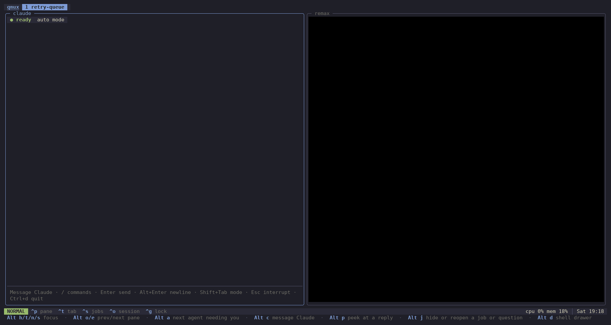

# remax

> [!WARNING]
> The current state of this repository is AI-generated and has not yet
> been human reviewed. Read accordingly.

Hunk-by-hunk code review with the **whole file on screen**: edit it
**in place** with modal keys in whichever flavor your fingers already
know — helix, vi, or emacs — and record per-line, content-keyed verdicts
that survive rebases.



*A commit-by-commit `:rebase` review, with the agent working the other
half of it. Below: the bar under the header tracks the rebase and the
commit under review, the tray lists hunks by file with their verdicts,
notes and progress meters, removed lines float inline beside what
replaced them, and the words that differ inside a changed line are marked
in place. Above: Claude Code, started with `/remax-review watch`, blocked
on `remax list --wait` until the reviewer flags a line — then it reads the
note, fixes the file and answers in the thread. Nothing is typed at remax
after the flag; the rewritten line arrives because the session is
watching the file. Neither of them prompts the other.*

*Recorded by `scripts/hero-cast`, which drives both panes for real —
that is a live Claude Code session, not a reconstruction.*

Prebuilt Linux binaries: every push to main updates the rolling
[`latest` release](../../releases/tag/latest) — download
`remax-linux-x86_64`, `chmod +x`, done.

```sh
remax                 # review everything uncommitted (working tree vs HEAD)
                      #   in a directory of checkouts rather than a repo, opens
                      #   the first and offers the rest to :repo
remax --base REF      # review the working tree against any ref
remax --branch        # against the merge-base with the mainline (whole branch)
remax --unstaged      # working tree vs index
remax --untracked     # new files only, reviewed as pure additions; ordinary
                      #   reviews already include them (:set untracked 0 to stop)
remax forget          # forget verdicts under the current directory (asks first)
                      #   in a folder of checkouts, reaches all of them
remax list [--json]   # flagged/questioned punch list for this repository
                      #   a leading space on a line means a remark on code the
                      #   change never touched, not feedback on the change
remax list --wait     # ... but block until it changes, so an agent can wait
                      #   on the reviewer rather than ask again on a timer
       --state FILE   #   measured from what you last saw, not from now, so a
                      #   change while you were busy is not missed
remax watching        # hold a mark in the session's header for as long as this
                      #   runs: working while the agent is busy, watching while
                      #   it is blocked on you, gone seconds after it dies
remax reply KEY TEXT  # agent posts in a note's conversation; shows live in the session
remax -C DIR ...      # any of the above, as if started in DIR
```

The buffer on screen is always the working file — editing edits the real
file — so the mode picks the *base* the diff decorates against. (There is
deliberately no index-vs-HEAD mode: with a directly editable buffer,
reviewing an index that differs from the worktree isn't coherent.)

## Push policy

Currently **"PR-less, except where polite."** New features may be pushed
to main at will, with the shared understanding that:

- **a)** we might decide to remove them,
- **b)** the workflow is in a high state of flux and experimentation, and
- **c)** if your new feature will significantly disrupt other users of
  the tool, experiment with it on a branch, discuss it in person, and
  possibly open a PR if that makes sense.

## Persistent by design

remax is built to be left open all day in a pane. The change set follows
your git activity on its own: commit from your shell and the reviewed
hunks leave the screen; when everything is settled the session shows an
"all clear" idle screen instead of exiting, and the next edit anywhere in
the repository wakes it. The CLI flags above are just starting values —
`:base`, `:mode`, and friends switch the view from inside. Verdicts are
keyed by line content, so they survive commits, rebases, and reloads; a
line that changes after being reviewed comes back as pending by itself.

Watching costs one inotify instance per session, and that is a scarce
per-user kernel resource — stock `fs.inotify.max_user_instances` is 128,
and a desktop with a few editors and sync clients running can hold every
one of them. When there is none left remax does not refuse to start: it
falls back to polling once a second, carries a `⚠ poll` badge in the
status line for the rest of the session, and tells you the fix on the way
in:

```sh
sudo sysctl -w fs.inotify.max_user_instances=512   # /etc/sysctl.d/ to keep it
```

While polling, git state and the file on screen are followed; an edit to
another file is picked up when you visit it.

## The screen

- Header: mode, current file, file/hunk position, pending count.
- Git bar: its own full-width line under the header, always there —
  the branch you're on (or `detached`), and the sha and subject of the
  commit HEAD is at, with `Space c` for the full message. During a
  rebase the same line becomes the rebase bar (step, sha, subject),
  because it answers the same question.
- Tray (left, `Tab` collapses): hunks grouped by file, with per-hunk
  marks — `·` pending, `✓` reviewed, `!` flagged, `?` questioned. The
  tool starts in **pending-only** mode: fully *reviewed* hunks fold under
  their file line — the file's progress meter (`▰▰▱ 2/3`) keeps the
  count — and `]`/`[` skip them; flagged and
  questioned hunks still count as pending — they need another look — so
  they stay listed and navigable. `Space p` switches to showing (and walking)
  every hunk, and `Space k` narrows to code-only or comment-only hunks.
  The current hunk always shows either
  way. `{` / `}` scroll the tray; it auto-centers on the current hunk
  when you jump. Long paths compress like `s/R/Quote.hs` so the file
  name always survives.
- The tray/body divider (thin `▎`, in the darker `ui.linenr` gray) runs
  the full pane height and doubles as the current-hunk indicator: across
  the current hunk's rows it widens to a half-block `▌` in the highlight
  color, so the hunk's extent reads at a glance. Next to it, a status
  column (`!` flagged, `?` questioned, `✓` reviewed, `•` pending — the
  cursor's row washes this cell's background dark gold while the glyph
  keeps its own color, so the line you're on still shows its verdict)
  and absolute line numbers — position and review state are always both
  visible. Removed lines have no number, keeping the numbering honestly
  absolute.
- Body: the whole file, scrollable, syntax-highlighted by **tree-sitter**
  (picked by extension, or by the **shebang** when there isn't one — so
  `scripts/build` highlights as bash on the strength of its first line,
  and `#!/usr/bin/env -S bash --norc` names bash rather than env)
  with **your helix theme** (the `theme` from `~/.config/helix/config.toml`,
  `inherits` followed, palette resolved; a built-in scope palette covers
  users without helix). The jellybeans base theme is embedded in the
  binary, so an `inherits = "jellybeans"` chain resolves even with no
  helix runtime on disk (AppImage installs mount theirs only while helix
  runs); other parents are found via `$HELIX_RUNTIME` or the usual helix
  theme directories. Colors render as exact 24-bit values when
  `COLORTERM` says the terminal can (the same signal helix trusts) —
  otherwise the terminal's palette approximation applies. Hunks are decorated in place by a live diff
  against the base: removed lines float inline in a muted rose, and
  reviewed lines keep their full syntax colors — the gutter column and
  the tray meters carry the review state, so settled code never turns
  murky.
- Status line: a quiet mode chip (`● nor` / `● ins`), the top-level
  declaration the cursor is inside, the overall progress meter
  (`▰▰▰▰▱▱▱▱▱ 4/9`), transient messages, and a short hint. The tray shows each hunk's enclosing
  declaration next to its line number, so hunks read as "which
  function", not just "which line". (Both use the column-zero heuristic
  the hunk splitter trusts; a tree-sitter-exact version can come later.)

## Keys

Normal mode:

| key | action |
|---|---|
| `h j k l` / arrows | move (collapses the selection, helix-style) |
| any prefix | `g`, `m`, `Space` and `Ctrl-x` put what they are waiting for in a box in the bottom-right corner, so the keys are on screen rather than in your head. `m`'s box is its own dispatch table, so it cannot describe itself wrongly. `f`/`t`/`r` have none — they take any character, and "type a character" is not worth a box |
| `w b e` | word motions — **the crossed span becomes the selection**, so `wc` is "change word", `ed` is "delete to word end" |
| `f F t T` + char | find / till a character (forward / back, across lines) — the crossed span becomes the selection |
| `gh gl gs` / Home End | line start / line end / first non-blank — on a long line the view scrolls horizontally to follow the cursor (gutter stays pinned); `gh` brings it home |
| `gg ge` | file start / file end (`:N` on the command line for a particular line) |
| `ga` | goto the alternate file (also `Space a`) |
| `v` | extend mode: every motion grows the selection; `;` collapses |
| `x` | select line, repeat to extend |
| `X` | select the current hunk — the review-unit object: `X r` reviews what you just saw selected, `X d` deletes it, `X >` indents it |
| `%` | select the whole file |
| `mm` | jump to the other half of the pair under the cursor |
| `ms<c>` | surround the selection: `ms(`, `ms"`, `ms{` — either bracket names the pair |
| `md<c>` / `mr<a><b>` | delete the surrounding pair, or swap it for another: `md(`, `mr({` |
| `mi<c>` / `ma<c>` | select inside / around the enclosing pair — brackets, `"`, `'`, `` ` ``, and `w`/`W` for the word under the cursor. Composes with the verbs: `miw` then `ms(` wraps the word, `mi(` then `d` empties the parens |
| `d` / `c` | delete / change the selection (char-wise or line-wise; or the char under the cursor) |
| `i a I A o O` | enter insert — editing is just editing |
| `~` | toggle case of the selection (or the char under the cursor) |
| `>` / `<` | indent / unindent the selected lines (2 spaces; blank lines untouched; selection survives for repeats) |
| `J` | join the selected lines (or current + next), comment-aware: joined lines shed their own comment leaders |
| `Q` | reflow to 80 columns, comment-aware: the selection, or the same-prefixed paragraph around the cursor, keeping indentation + comment leader (`--`, `-- \|`, `//`, `#`, `;;`…) on every line |
| `r` + char | replace every character of the selection (or under the cursor) with that character, helix-style |
| `u` | undo |
| `y` | yank the selection (or cursor cell) — line-wise for `x` selections; the yank slot is session-wide, so paste works across files (and the note popup), and it goes to the **system clipboard** too |
| `p` / `P` | paste after / before: whole lines below/above for a line-wise yank, after/at the cursor otherwise; the paste is selected. Pastes the **system clipboard** when it holds something copied outside the session, the yank slot otherwise |
| `Space` | menu (helix-style infobox): `⏎` accept, `!` flag, `q` question, `x` select the hunk (all four also live on their own keys here, and are the *only* way to reach them in the vi keymap), `f` file picker, `b` open files, `t` project tree, `n` note popup, `e` `$EDITOR` here, `p` pending filter, `k` code / comment filter, `u` resolve the note here, `h` make the hunk under the cursor the current one, `a` bounce to the alternate file (the one before the last file jump, hunk restored), `/` project-wide search, `c` full message of the commit under review |
| `.` | repeat the last insert session (the entering command plus what was typed), helix-style — `c`-fix-`Esc` then `.` applies the same change at the cursor |
| `Enter` | **accept the selection as reviewed** — a selection is required, so what you accept is always visibly highlighted (`X Enter` for the hunk you're looking at). Completing a hunk jumps to the next pending one; a partial mark steps to the next line |
| `!` / `?` | flag-to-return-to / question — the selection's lines, or the whole current hunk with none. The note popup opens immediately for the reason (`note-on-flag = 0` in the config turns that off); discarding it (`Ctrl-c`, or `Esc` from its normal mode) cancels the mark as well, since the verdict has not been explained yet — save an empty note to keep the mark without one. The jump to the next hunk waits until the popup closes, and never happens if the mark is cancelled |
| `]` / `[` | next / previous hunk, crossing file boundaries |
| `Space k` | cycle what `]`/`[` and auto-advance walk: every hunk → only hunks that touch **code** → only hunks that are all **comment** (`:filter all\|code\|comments` names one outright). Reading a branch's prose and reading its logic are different passes. A hunk counts as comment when every non-blank line it changes is a line comment, opens a block comment, or sits inside one — so a hunk that adds a comment *beside* a code change is code. Independent of the pending filter, so "the code hunks nobody has looked at yet" is the two together; the header says which filter is on, and an exhausted walk says which one emptied it |
| `/`, `n` / `N` | search the file (literal, helix-shaped: the match becomes the selection); repeat forward / back, wrapping |
| `Space /` | project-wide search (`git grep` behind the picker; also `:grep TEXT`): type, pick a hit, Enter jumps to the file and line with the match selected — and `n`/`N` then walk the **hit list across files** without re-searching (a fresh `/` or `*` returns them to in-file duty). The results box stretches to the pane width so lines keep their context |
| `:` | the command line — see below |
| `*` | search for the selection (single-line) or the identifier under the cursor — primes `n`/`N` and jumps to the next occurrence |
| `'` | jump back to the hunk under review — **global**: review-flow navigation (`]`/`[`, auto-advance, `Space h`) drops the anchor there, and investigation moves (pickers, `Space /`, `ga`, `:open`) don't touch it, so wandering off to check something always has a way home |
| `E` | suspend and open `$EDITOR` (hx-aware: helix gets `file:line`, classic editors get `+line`) on the current file at the cursor's line; the session reloads whatever you changed when you return |
| `)` / `(` | next / previous file — browsing moves (`)`/`(`, `ga`, pickers) keep each file's own cursor position, so coming back finds it where you left it |
| `Ctrl-p` | fuzzy file finder over the whole repository (tracked + untracked); type a subsequence, Enter opens, Esc closes |
| `Tab` | collapse / expand the tray |
| `{` / `}` | scroll the tray |
| `:q` | quit (prints the pass summary and punch list) — bare `q` is deliberately unbound, reserved for the future |

During a rebase the status line and header carry the rebase state; all
normal review keys keep working at every stop.

Jumping to a hunk parks the cursor on its first line still needing
attention. The cursor roams freely without changing the current hunk:
`Space h` makes the hunk it's standing in the current one, and a
selection-less hunk verb (`X`, `!`, `?`) refuses when the cursor isn't
inside the current hunk, rather than acting on one out of view — the
refusal names `Space h` as the way to move the current hunk to where you
are. A session opens on the
first hunk nothing has been said about yet, and auto-advance walks the
same way: fresh hunks first,
circling back to the flagged and questioned ones only when nothing
unvisited remains. Splitting never severs a block comment — a blank
line inside `{- -}`, `/* */`, or `<!-- -->` is prose, not a boundary,
and cut points avoid the middle of comment runs. Oversized hunks (>20 changed lines) split automatically, in
three tiers: always at function boundaries (a blank changed line
resuming at column 0) — and never re-merged across one, however small
the functions; within a function, anything over `piece-max` lines splits
at its interior blank lines, with pieces under `piece-min` merging
forward; a blankless slab still over the cap cuts at its least-indented
line. All three knobs live in the config file. Content-keyed
verdicts are indifferent to where the boundaries fall.

Insert mode: type, Enter, Backspace, Del, arrows, paste; `Esc` returns to
normal mode and **writes the file to disk**. Normal-mode edits that don't
enter insert (`d`, undo) write immediately; ones that do (`c`, `o`)
write when insert exits. There is no explicit save and no dirty state in
normal mode — what you see in normal mode is what's on disk.

## The system clipboard

Copying reaches it and pasting reads it, in every keymap, with no keys to
learn: `y` (vi's `y`/`yy`/`Y`, emacs's `M-w`) puts the text on the system
clipboard as well as the session's own yank slot, and `p`/`P` (emacs's
`C-y`) paste the clipboard when it holds something copied outside the
session, the yank slot otherwise.

**Deletes never touch it.** `d`, `x`, `c` — and vi's registers, which
fill on delete so that `dd` then `p` moves a line — stay session-local,
so ripping a line out of a file cannot clobber what you copied from a
browser. Emacs's `C-w` and `C-k` are cuts by the same reasoning; `M-w` is
the copy.

The route is picked once at startup: `wl-copy`/`wl-paste` on Wayland,
`pbcopy`/`pbpaste` on macOS, `xclip` or `xsel` on X11 — and with no
helper (or no display server at all, which is what an ssh session looks
like) copying falls back to **OSC 52**, the escape sequence the terminal
itself forwards, so a yank still reaches the clipboard of whatever
machine you are sitting at. That route is write-only: terminals that
implement the read side almost all disable it, since it would let
anything on the far end of a pipe read what you last copied. Pasting
there falls back to the session slot, and a paste with nothing in either
place says which of the two reasons applies.

Terminal paste (`Ctrl-Shift-V`) is unaffected — bracketed paste has
always worked in insert mode, and in normal mode `p` is the answer.

## Vi keys

`keys = vi` in the config (or `:set keys vi`, live — `vim` works too)
swaps the buffer to vi's grammar: the operator comes first and waits for
its motion, which is the mirror image of the helix layer rather than a
second editor. The verbs underneath are the same ones the helix keys
drive; only the order of the keystrokes changes.

| what | keys |
|---|---|
| operators | `d` `c` `y` `>` `<`, and `gu` / `gU` / `g~` for case — over any motion (`dw`, `d$`, `dfx`), doubled for the line (`dd`, `cc`, `yy`, `>>`), with counts on either side (`d2w`, `2dd`) |
| text objects | `iw aw iW aW ip ap` and the pairs `i( a( i{ a{ i[ a[ i< a< i" a" i' a'` (`ib`/`aB` alias the brackets) — so `ciw`, `di(`, `ya"` all work |
| motions | `h j k l`, `w b e` / `W B E`, `ge` / `gE`, `0 ^ $`, `gg` / `G` (with a count: `23G`), `f F t T` with `;` / `,`, `%` to the matching bracket |
| shorthands | `x X D C s S Y`, `p` / `P`, `J`, `r`, `~`, `u` / `Ctrl-r`, `.` — `y` reaches the system clipboard, `d`/`c` fill the unnamed register only |
| insert | `i a I A o O`; `Esc` returns to normal mode and writes the file, as everywhere else |
| visual | `v` char-wise, `V` line-wise; motions extend, an operator acts on what is highlighted |
| searching | `/` forward and `?` **backward** — the prompt wears the sigil it opened with, and `n` / `N` repeat along that grain. `*` / `#` take the word under the cursor either way |

The review verbs move behind the `Space` leader, the way the emacs
keymap puts them behind `C-c`: `Space ⏎` accept, `Space !` flag,
`Space q` question, `Space x` select the hunk. Everything else on the
`Space` menu is unchanged, and the note popup gets vi keys too.

What keeps its remax meaning is **structural navigation** — `]` / `[`
hunks, `)` / `(` files, `{` / `}` the tray, `'` back to the hunk under
review (nearly what vi's `''` does anyway), `Tab`, `Ctrl-p`, `:`. That
is the tool's own vocabulary rather than the editor's; vi's sentence and
paragraph motions are the price. Everything else in the buffer is vi's:
`?` searches backward, `X` deletes leftward, and `E` is the WORD motion
(`Space e` opens `$EDITOR` here).

Not implemented, and unlikely to be: registers (`"a`), marks and the
jumplist, blockwise visual (the selection model is char- or line-wise
only), and `R` replace mode.

## Emacs keys

`keys = emacs` in the config (or `:set keys emacs`, live) swaps the
buffer to modeless emacs editing: printable keys self-insert and write
through on every edit. `C-f/b/n/p` and arrows move, `C-a`/`C-e` line
ends, `M-f`/`M-b` words, `M-<`/`M->` file ends; `C-space` sets the mark
and the region is the selection the review verbs consume; `C-w`/`M-w`
kill/copy the region (`M-w` also reaches the system clipboard; the cuts
do not), `C-k` kills to end of line, `C-y` yanks,
`C-_` (aka `C-/`) undoes, `C-g`/`Esc` clears the mark. `M-x` opens the
command line, `C-s` the search prompt. Review verbs live behind the
`C-c` prefix with the same letters as the helix keys — `C-c Enter`
accept, `C-c !` / `C-c ?` flag/question, `C-c x` select hunk,
`C-c ]`/`C-c [` hunks, `C-c p` pending filter, `C-c f` files — and
`C-x C-c` quits, `C-x C-s` saves (edits already write through). The
note popup keeps its modal keys in either keymap.

## The : command line

| command | action |
|---|---|
| `:base` | pick the base out of the history: a picker over this branch's own line of development (`--first-parent`: a merge is one row, and what it brought in stays out) in aligned columns — short sha, how long ago, what points there (`HEAD -> main`, `tag: v1.0`), subject — with `HEAD` and `branch` on top. Type to filter on any of it, including a name too long to fit on screen, `⏎` reviews the working tree against the row you land on, and whatever you're reviewing against now is marked `← current`. Any commit reachable from HEAD is a legal base, so `:base SHA` still names one the picker leaves out |
| `:base REF` | review the working tree against REF (any commit-ish) |
| `:base branch` / `:branch` | against the merge-base with the mainline — the whole branch diff, fixes land at the tip |
| `:mode head` / `:mode unstaged` / `:mode untracked` | the classic change sets |
| `:rebase [REF]` | start a commit-by-commit review pass (below) |
| `:continue` | fold this stop's edits into the stopped commit and advance — *everything* dirty at the stop counts, including edits made through `$EDITOR` or by an agent, since the stop started clean |
| `:abort!` | abort the rebase (`:abort` asks first) |
| `:amend` | open the commit message of the commit under review (HEAD; the stopped commit mid-rebase) in the popup editor — `⏎` in its normal mode amends. Outside a rebase the session's edits fold in with it; at a rebase stop the amend is message-only (`:continue` owns the folding) |
| `:note TEXT` | post a one-line note on the lines just marked `!`/`?` (or the selection) |
| `:note` | open the note popup — a small modal buffer (full editing keys); text auto-wraps; `⏎` in its normal mode saves, `Ctrl-c` (any mode) or `Esc` in its normal mode discards, saving empty clears the whole conversation. Discarding a popup that `:note` opened leaves the verdict alone — only one opened by `!` or `?` takes its mark with it. A note opened that way covers every line the mark just wrote, and accepting a hunk retires the whole of it: the conversation closes and any lines outside the hunk that were part of the same mark lose their verdict too, since one keystroke made them and one retires them. Lines beside them carrying a *different* conversation are untouched, even one worded identically. Notes are a **conversation**, and the popup shows it: the thread so far sits above what you're typing (`≡ you`, `↪ them`, oldest first, the newest kept when a long thread won't fit), the frame names the line you're annotating, and the title and the verb say which of the three things is happening — a new `note`, `editing yours` when your post is the newest and reopens for rewriting, or `reply to NAME` with `⏎ post` once someone has answered. From any line of a hunk that carries a conversation, `:note` continues that thread |
| `:unnote` / `:resolve` | drop the whole conversation from the same target |
| `:resolve all` | sweep every **answered** conversation in the repository — any thread whose newest post isn't yours clears; threads awaiting an answer stay |
| `:filter all` / `:filter code` / `:filter comments` | which hunks `]`/`[` and auto-advance walk; bare `:filter` cycles (also `Space k`) |
| `:accept PATH` | mark every hunk under a directory (or in one file) reviewed — the bulk verb for generated code; matching is by path component |
| `:open PATH` / `:close` | open any repository file in the session / drop it again |
| `:repo` | switch which repository the session is looking at (also `Space R`, or `:repo NAME`). Start remax in a directory that *holds* checkouts rather than being one — a story directory of worktrees, say — and it opens the first and offers the rest here, with each row's branch and state (`clean`, `3 changed`, `rebasing 2/7`, `CONFLICT`) so you can see which one wants you. Your place in a repository is remembered, so leaving one mid-rebase and coming back lands you on the same hunk with the rebase still in progress — that state lives in `.git` and is read back on arrival, while buffers are re-read from disk, since the reason you stepped away may well have been to let an agent work there |
| `:files` | the file finder (also `Ctrl-p`, `Space f`) — every file on one level, best match first. It is the same dialog `:tree` opens, in its flat mode, so it carries the same status letters, `+N −N` and review meters, and a file expands into its hunks here too. `↹` switches to the tree without losing your filter or your place |
| `:tree` | the project tree (also `Space t`): every file in the repository, with git's status letter and `+N −N` per file in the same green and rose the body uses, directory rollups so a folded directory still shows its weight, and the review meter for files the session has hunks for. `→`/`←` fold — a directory into its files, **a file into its hunks**, which arrive with the tray's own `· ! ? ✓` marks, line numbers and enclosing declarations. `⏎` expands a directory, jumps to a hunk, or opens a file. Typing **narrows the tree in place** rather than flattening it: matching files survive, and the directories holding them survive and open themselves. Deleted files appear here — with `D` and their removed count — even though the change set itself cannot show them |
| `:N` | jump to line N of the current file, clamped to its ends — the cursor moves, the hunk under review and the `'` anchor don't |
| `:edit [PATH]` | suspend into `$EDITOR` at the cursor (or on PATH) |
| `:checkout` | switch branches — a picker over local branches in the same columns (branch, how long ago, the tip you'd land on, subject), most recently committed first with `← current` marked; `⏎` checks out. `:checkout NAME` skips the picker. Refused mid-rebase |
| `:q` | quit |

The command line completes itself: a bare `:` lists every command with
a one-line description, typing narrows the menu, and `Tab` /
`Shift-Tab` cycle completions — command names first, then that
command's arguments (refs for `:base`/`:rebase`, files for
`:open`/`:edit`, directories for `:accept`, modes for `:mode`). A bare
number isn't a command name at all — it reads as a line address, and the
menu says which line it will take you to.

A file opened by hand arrives with zero hunks (it reviews against its
own content at open time), stays pinned across git refreshes, and any
edits you make to it decorate as hunks like everything else. Note
conversations render inline under the block they annotate — your posts
as `└ ≡ …`, everyone else's as `↪ name · …`, oldest first — and hunks
carrying one show `≡` in the tray.

Every base or mode switch closes the current review pass and opens a new
one, so pass history records what was reviewed against what.

## Reviewing a branch commit by commit

`:rebase` (optionally `:rebase REF`) runs `git rebase --exec false` from
the merge-base: the failing exec pauses the sequencer after **every**
commit, and the session follows along — the header shows
a full-width bar with the step, sha, and whole subject (`Space c` or
`:commit` pops the full message — author, date, body), the hunks are
that commit's changes, and any
edit you make lands in *that commit* when `:continue` amends and
advances. A conflict stop is labeled `CONFLICT`; resolve it in the buffer
and `:continue`. This is the surgical alternative to the ambient
`:base branch` view (where fixes land at the branch tip).

The session never runs git on its own — those six commands (with
`:checkout`) are the only mutation points, each one explicit. The awareness half works with zero
commands too: drive `git rebase --exec false`, `--continue`, `--abort`
from your shell and the open session tracks every stop.

## Working with agents

The review loop closes with coding agents. An agent's edits stream into
your open session live (files reload, touched lines return to pending);
your feedback flows back through the store:

1. Mark a line or hunk `!` (fix this) or `?` (explain or fix), and give
   the reason: `:note use mapMaybe here instead`.
2. The agent runs `remax -C /path/to/repo list --json` and gets file,
   verdict, exact line text, position, and your note. Feedback given
   during a `:rebase` stop also carries the commit it is about
   (sha + subject — final values, since stops only rewrite forward), so
   an agent can land fixes in the introducing commits; ambient feedback
   carries no commit and agents recover one from the line text with
   `git blame` when it matters.
3. For a `?` it can answer in place: `remax reply KEY "text"` (the key
   comes from the JSON) posts into the note's conversation, rendering
   live in order under your note, marked `↪` with the author's name.
   The thread is ordered and two-way: answer their post with `:note`
   and it appends as your follow-up. **Accepting the lines resolves the
   whole conversation** — the thread clears when you mark them
   reviewed, so "read the answer, `X Enter`" is the one-gesture close.
   `Space u` dismisses a conversation without accepting anything.
4. It fixes the code; the fixed lines automatically come back as pending
   in your session; you accept or push back.

`skills/remax-review/SKILL.md` teaches Claude Code this protocol — copy
or symlink it into `~/.claude/skills/` (or a workspace `.claude/skills/`)
so agents pick it up.

## Configuration

`~/.config/remax/config.toml` — flat `key = number` lines, `#` comments,
every key optional (defaults shown):

```toml
keys = helix          # helix | vi | emacs
scrolloff = 5         # rows kept visible around the cursor
note-wrap = 58        # auto-fill column in the note popup
note-on-flag = 1      # ! and ? open the note popup immediately
split-threshold = 20  # hunks at or under this never split
piece-min = 6         # smaller pieces merge forward (within a function)
piece-max = 32        # bigger pieces keep splitting
```

`keys = helix` (default), `keys = vi`, or `keys = emacs` picks the
keybinding family.
Every setting can also be changed live from inside the session:
`:set` lists current values, `:set KEY` shows one, and `:set KEY VALUE`
applies immediately (split knobs re-split on the spot) and persists to
the config file. Unknown keys and unparsable lines are ignored. A `.remaxignore` at the
repository root (one pattern per line, `#` comments) keeps files out of
the change set entirely: a path prefix matched by component (`gen`
covers `gen/a.txt`, not `generated.hs`) or a `*suffix` form
(`*.min.js`). Check it in — generated trees are a team-wide fact.
Ignored files can still be `:open`ed. A file git does not track yet is
part of the review as soon as it is written, reviewed as a pure addition
— `:set untracked 0` leaves them out for a repository full of stray
files. `:open` of a path belonging to another checkout this session knows
about switches there and opens it, so its verdicts are recorded against
the repository that owns it. The header's pending
count reads `N pending here · M overall` — per current file, and across
the whole change set.

## How review state works

Each changed line is keyed by content — repository, file, the line text
with its `+`/`-` marker, and a copy ordinal for identical twins — under
the `remax/1` scheme.
Keys carry no positions, so verdicts survive line shifts, rebases, and
hunk-boundary changes. A hunk is pending while any of its lines lacks a
verdict; add one line to a reviewed hunk and it comes back with the old
lines dimmed.

Verdicts live in `~/.local/state/remax/review.db` (sqlite): `line_verdict`
rows (key, file, line text, verdict, pass) plus a `pass` table recording
when each review ran and what scope it covered.

## Filesystem awareness

A watcher on the repository keeps the screen honest while you work
elsewhere (helix, git, a build):

- a watched file changed on disk → reloaded in place, decorations rebuilt
  (if you're mid-insert, your edit wins on Esc and a warning shows)
- `.git` index/HEAD/refs changed → the change set is re-listed: new files
  appear, vanished ones drop out, changed bases re-diff (throttled to
  twice a second; `dist-newstyle`/`.stack-work`/`node_modules` ignored)

## Performance

Startup watches only the directories holding changed files plus `.git`
(never a recursive walk over build artifacts), and syntax highlighting is
computed lazily — a file gets its real colors the moment it is first
shown, never sooner. Decorations are cached per file and rebuilt only on
text change; while typing, only the edited line is re-tokenized.
Rendering materializes only ±300 rows around the cursor. The diff runs
under a 400ms budget (a heavily rewritten file degrades to one
whole-file hunk instead of hanging), tokenization under 800ms (degrades
to plain text), and files over 10k lines render plain outright — they
are almost always generated. The text buffer is a purpose-built line
zipper (Remax.Zipper): the off-the-shelf one constructed its state
character by character, quadratic in line count. Measured: ~50ms to first frame on a small
change set; ~1.5s on a 35-file set with several 4k-line files inside a
20k-directory repo.

One trade from selective watching: a file in a directory containing no
changed files won't fire a watcher event when edited; its entry into the
change set is noticed at the next git-state event instead.

## Highlighting

Tree-sitter, fully self-contained: the MIT runtime and ten grammars are
compiled into the binary (haskell, purescript, yaml, json, toml,
hcl/terraform, sql, bash, nu, markdown — all MIT except hcl's
Apache-2.0), with helix's highlight queries embedded (MPL-2.0,
file-level; see vendor/grammars/QUERY-LICENSE.md). Query predicates
(#eq?, #any-of?, and #match? in its anchored-alternation form) are
evaluated; painting follows the innermost-node-wins rule. Markdown
covers block structure (headings, lists, quotes, fences); inline
emphasis and links live in a separate injection grammar not yet wired. No system
tree-sitter, no helix installation, and **no GPL anywhere in the
dependency tree**. Languages without a vendored grammar render plain —
vendoring another is copying its sources under vendor/grammars and adding
one table entry.

## Development

The repo follows the flipstone house layout: `./scripts/bootstrap` once
(creates the shared stack volume and `.env`), then `./scripts/test`
builds in the `haskell-tools` dev container (`compose.yaml`), and
`./scripts/build` formats with fourmolu first. `package.yaml` is the
source of truth — `remax.cabal` is hpack-generated. Plain `cabal build`
also works outside the container.

### Documents

`docs/watching-mechanism.html` draws how the watching/working mark in the
header is arrived at: what the agent's two processes write, what the
session polls, why the heartbeat is a directory of files rather than a
row in the store, and what each way of losing an agent looks like from
the reviewer's side. Open it in a browser; it is self-contained.

### The hero recording

`scripts/hero-cast` regenerates `hero.gif` with no human at a terminal:
it builds the standard state with `scripts/hero --no-launch` (a scratch
repo at `/tmp/remax-hero` mid-rebase, stopped on its first commit,
seeded with accepted files, a flagged hunk and a questioned hunk with
notes, and the current file's hunks left pending — store and config
sandboxed under the scratch directory), then drives a short review
through a pty and records the emulated screen.

The recording is scripted in `tour` in `scripts/lib/hero_cast.py`, which
drives two tmux panes: remax below, and a real Claude Code session above,
started with `/remax-review watch` and reacting on its own from there.
Frames are drawn cell by cell with Pillow rather than screenshotted, so
it needs `python3` and a monospace TTF and no browser; pyte and pillow
install into a scratch venv on first run.

That Claude session gets a throwaway `CLAUDE_CONFIG_DIR`
(`scripts/lib/hero_claude.py`) with the first-run wizard, the trust
prompt and the permissions already settled, and the skill installed where
it will look for it — an allowlist rather than
`--dangerously-skip-permissions`, whose warning screen would otherwise be
the first thing on camera. Credentials are symlinked, never copied into a
scratch directory. It costs real model calls, so regenerating is not
free, and no two takes are alike.

Waiting on a model is most of the elapsed time and none of the interest,
so those stretches are recorded as a time-lapse: sampled rarely and
played back fast. Without it a spinner defeats the frame collapsing
entirely and six minutes of wall time becomes six minutes of GIF.

Two things the tour depends on, if you rewrite it. The flagged line is
one that was purely added, since flagging a *changed* line covers both
its removal and its addition and renders the note under each. And the
seeded state leaves exactly one question outstanding: `watch` answers the
punch list before it settles down to wait, so anything seeded is work the
agent must finish before it can react to what happens on camera — and a
flagged line asking for a code change costs minutes of that.

Expect the note to come off its line once the agent fixes it. Verdicts
are keyed by line content, so a rewritten line is a new line and goes
back to pending for the reviewer — which is the design working, and worth
knowing before you wonder where the conversation went.

To eyeball or restage the state by hand, `scripts/hero` builds the same
state and launches remax in it.

## Known v1 edges

- Clipboard reads spawn the helper on each paste, so a wedged `xclip`
  costs a two-second timeout once rather than a hung session.
- Word motions are line-local in the helix keymap; that subset is
  deliberately small ("finer points to be negotiated"). The vi keymap's
  motions do cross lines.
- The code/comment filter classifies textually (comment leaders and
  block-comment tracking), not by tree-sitter: scoped tokens exist only
  for files that have been displayed, and never for the removed side of
  a diff, which is exactly the set the filter has to walk.
- Files without a trailing newline gain one on first write.
- The line being edited shows plain (uncolored) while insert mode is
  active; colors return on Esc when the full tree-sitter pass reruns.
- Binary files are skipped.
